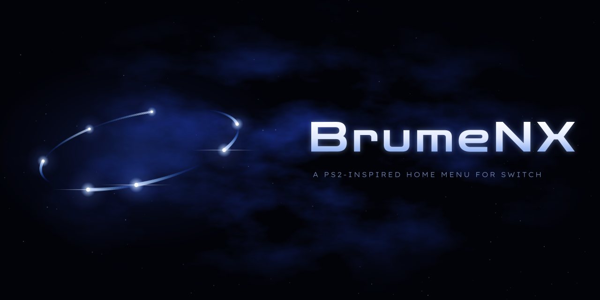
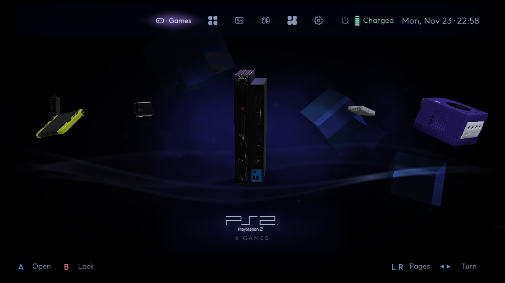
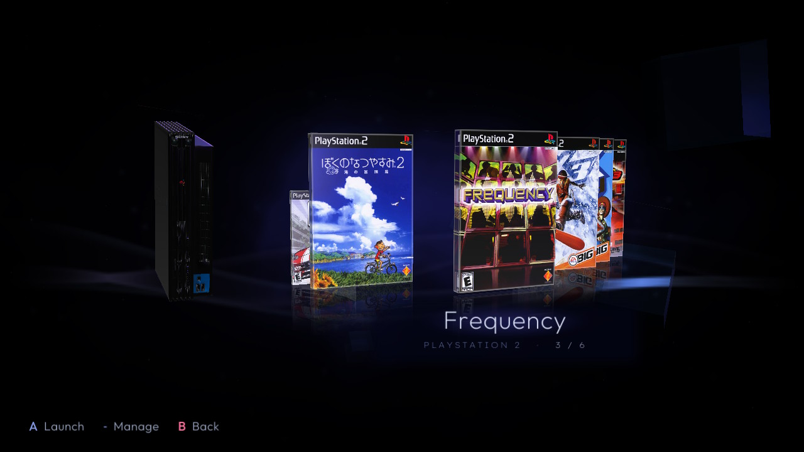
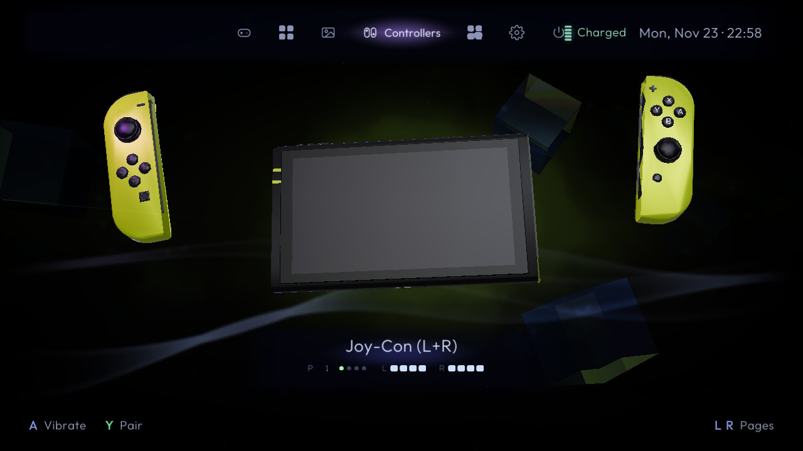
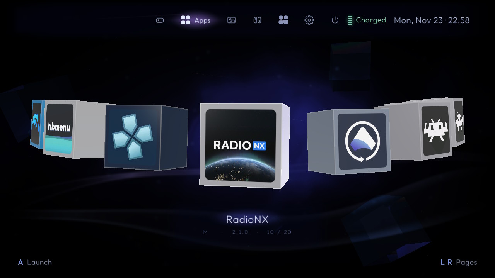

  

  <b>A custom HOME menu for the Nintendo Switch, inspired by the PlayStation 2 boot screen.</b> 
  Blue fog that breathes, lights that drift, glass that bends the light, and a sound for every gesture.

<h3 align="center">HEADPHONES RECOMMENDED</h3>

  

---

| | |
|---|---|
|  |  |
|  |  |

## What it is

- **A lock screen in the dark**: three presses send three waves of light, then a big bang opens the menu.
- **A 3D console wheel** (Switch, PS2, GameCube, N64, PlayStation, PSP, GBA, DS, ports…). Emulators on your card are found automatically.
- **Your games in real 3D boxes**, covers downloaded by the console. On launch, the disc flies into *its* console.
- **Real pages** (L / R): Games, Apps, Album, Controllers (your Joy-Con colours, live), Settings wired to the real system settings.
- **60 FPS** on a launch Switch, and **zero cost while a game runs**.

> Unofficial fan project, not affiliated with Nintendo or Sony. No games, BIOS, keys or official covers included.
> **emuMMC only.** This is a **pre-release**: things may still break.

## Tested consoles

I could only test on **my own Switch (V1)**. If you try another one, please tell me in an [issue](../../issues) so this
table grows.

| Console | Firmware | Atmosphère | Status |
|---|---|---|---|
| Switch V1 (Erista) | 22.5.0 | 1.12.2 | Validated |
| Switch V2 (Mariko) | | | Not tested yet |
| Switch Lite | | | Not tested yet |
| Switch OLED | | | Not tested yet |

## Install

1. Download `brumenx-<version>.zip` and the installer from the [Releases](../../releases).
2. Run the installer next to the zip (`install-brumenx.bat` on Windows, `install-brumenx.sh` on macOS / Linux).
   It checks every file, backs up what it replaces, deletes nothing.
3. Boot Atmosphère on your **emuMMC** and press any button three times.

Your Switch games are already there. For the other consoles, bring your emulator and your own games:

| Console | Emulator (anywhere in `switch/`) | Your games in |
|---|---|---|
| PS2 · GameCube · PSP · DS | NetherSX2 · Nezumiiruka / Dolphin · PPSSPP · DraStic / melonDS | `roms/ps2` · `roms/gc` · `roms/psp` · `roms/nds` |
| N64, PS1, GBA, SNES, NES, Mega Drive, Game Boy… | RetroArch (cores in `retroarch/cores/`) | `roms/n64`, `roms/psx`, `roms/gba`, `roms/snes`… |

PS1 / PS2 need your own BIOS. Restart, and the consoles appear on the wheel. More: [`docs/INSTALL-EN.md`](docs/INSTALL-EN.md).

**Rescue**: hold **L + R + −** for 3 s, or on the PC rename `atmosphere/contents/0100000000001000` to
`0100000000001000_off` (always works, even on a black screen).

## Roadmap

- **Spotify** inside the menu, playing on during your games
- **The disc goes in, and comes back out**: a real insertion for each console, and the disc back in its box when you quit
- **Real forwarders made by BrumeNX itself**: every emulator and app with its own icon, nothing borrowed
- **A first-boot setup** in the fog: language, colours, clock font, Wi-Fi, all live
- **Game sounds on hover**, like the Wii channels and the 3DS banners
- **Our own HOME panel in game**: performance, notes, music
- **PS3-style liquid glass** for the settings icons, and more consoles

## Thanks

- **Horizon-OC** for [qlaunch-ext](https://github.com/Horizon-OC/qlaunch-ext), the loader that makes a custom HOME menu
  possible, and **etonedemid** for [sLaunch](https://github.com/etonedemid/slaunch), its fixes and the best reference
  there is for the system side.
- **SciresM and the Atmosphère team**, **CTCaer** for Hekate, **switchbrew** for libnx, **fincs** for deko3d.
- The **Sketchfab artists** behind the 3D consoles: gabrieljuan0322, Smoggybeard, Jeffrey fan 2000, DevonCarlson,
  ecjhr0awipso, Ilya Ostrovsky and thegraphicsgeek.
- The people who took the PS2 menu apart in public: **osdbits**, **CrystalOSD** and **richiepreece/clock**.
- The font designers (Zen Dots, Outfit, Lexend and the clock fonts, all under the SIL OFL), **Wikimedia Commons** for
  the console logos, **libretro-thumbnails** and **GameTDB** for the covers, **Project Nayuki** for the QR codes.
- The **emulator developers**, without whom there would be nothing to launch.
- And everyone on r/SwitchPirates who commented on the first post: this release exists because of you.

## Licences

BrumeNX is free software under the **GPL-3.0-or-later** ([LICENSE](LICENSE)). Every third-party component keeps its own
licence, and all of them are listed in [THIRDPARTY.md](THIRDPARTY.md) (with their full texts in the release zip,
`brume/docs/LICENCES/`). The N64 and PS2 3D models are for non-commercial use only. Nintendo Switch, PlayStation and the
other console names and logos are trademarks of their owners, used only to name the consoles.

**En français** : installation et secours dans [`docs/INSTALL-FR.md`](docs/INSTALL-FR.md), guide complet dans
[`docs/INSTALLATION.md`](docs/INSTALLATION.md).

---

### Made with AI

C++ isn't my thing (yet), but this project really meant a lot to me, so BrumeNX was coded with AI.
The code is all open: feel free to read it and improve it.

*Le C++ c'est pas encore mon truc, mais ce projet me tenait à cœur : BrumeNX a été codé avec une IA.*
